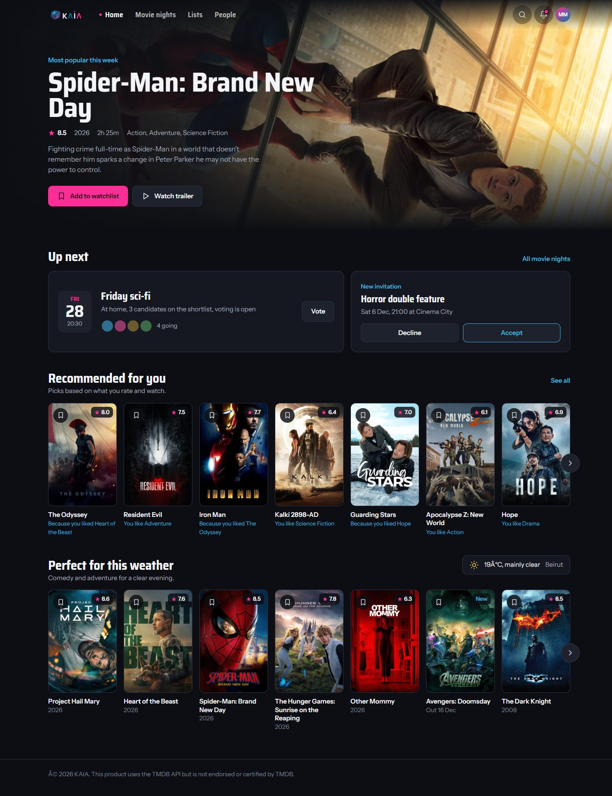
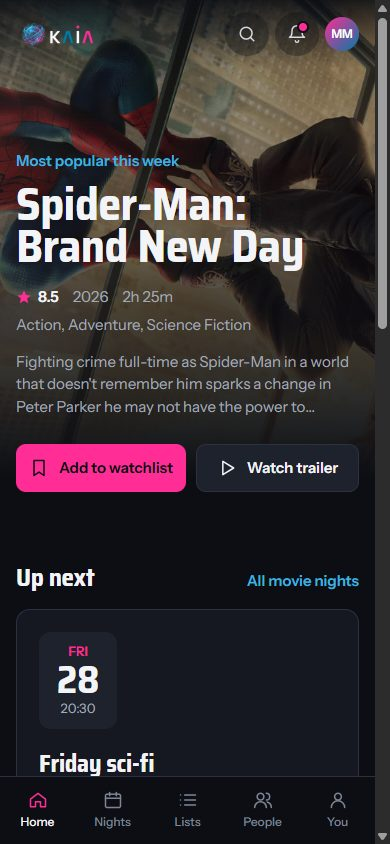
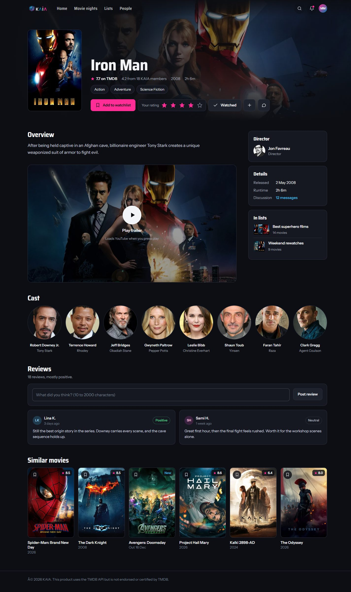
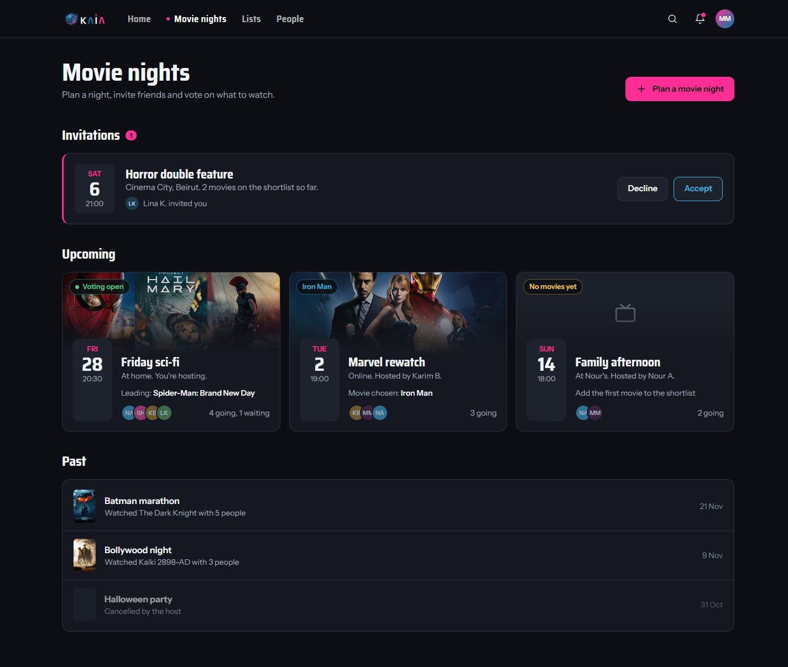
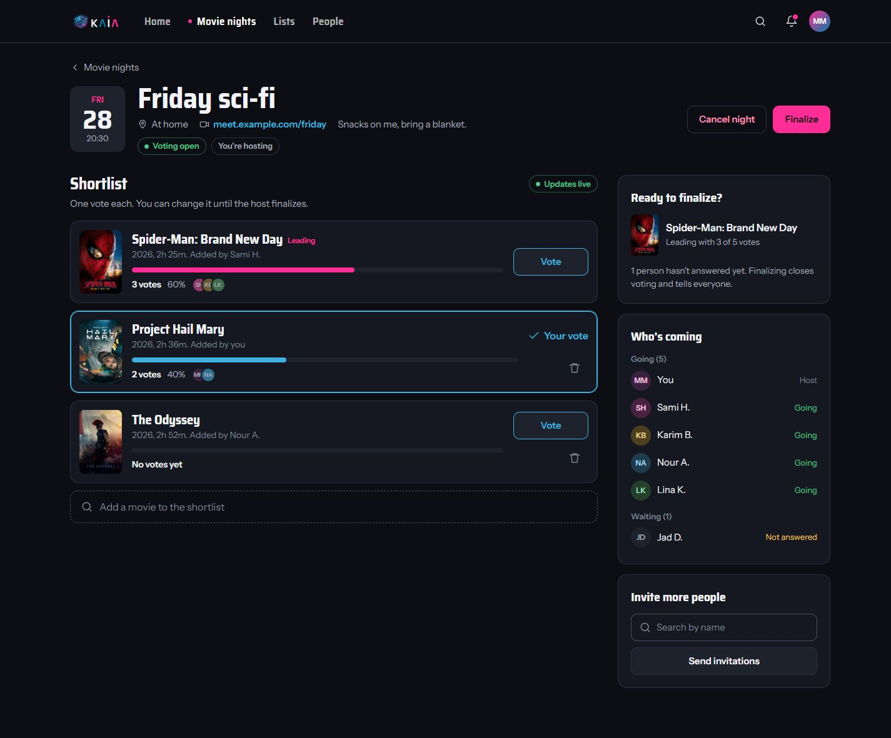
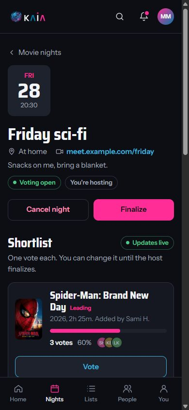

# UI mockups (Cinema dark)

Agreed on 2026-11-25 as the target for the Sprint 6 redesign tasks. They are static HTML pages, not app code: open any
`.html` file in a browser and resize the window to see the phone layout. Colours and fonts follow task 1342 and are in
`mockup-base.css`. Movie data and posters are real (from Catalog and TMDB); people, movie nights, votes, reviews and
lists are made-up example data.

| Task | Page | Mockup | Images |
|---|---|---|---|
| 1337 | Header ("Cinema overlay", option B) | `header-options.html` |  |
| 1338 | Home | `home-mockup.html` |   |
| 1338 | Home section states | `states-mockup.html` |  |
| 1340 | Movie page | `movie-mockup.html` |   |
| 1364 | Movie nights list | `nights-mockup.html` |  |
| 1364 | Movie night, voting open | `night-mockup.html` |   |
| 1364 | Movie night, finalized | `night-mockup.html#final` |  |

## Rules shown in the mockups

- **One pink button per screen** (the main action); blue is for links, focus and "your vote".
- **Section states:** hide an empty section the user can't act on (trailer, cast, in lists, similar movies); show a
  short empty state with a button for features the user can start (watchlist, recommendations, first movie night);
  always show the one-line notice when a service is down; placeholders the same size as the content while loading.
- **Header:** transparent over the backdrop on home and the movie page, solid after scrolling and on every other page.
- **Phones:** bottom tab bar (Home, Nights, Lists, People, You); on the movie page the actions move to a bar at the
  bottom.
