# UI mockups (Cinema dark)

Agreed on 2026-11-25 (admin, cinemas, people and shared pieces added on 2026-11-28) as the target for the Sprint 6
redesign tasks. **Before you start a UI task, find its number below and build to its images.** They are static HTML
pages, not app code: open any `.html` file in a browser and resize the window to see the phone layout. Colours and
fonts are the tokens from task 1342 (`gateway/resources/css/app.css`, swatches on `/dev/components`); in the mockups
they live in `mockup-base.css`. Movie data and posters are real (from Catalog and TMDB); people, movie nights, votes,
reviews, cinemas, counts and lists are made-up example data.

| Task | Page | Mockup | Images |
|---|---|---|---|
| 1337 | Header ("Cinema overlay", option B) | `header-options.html` | 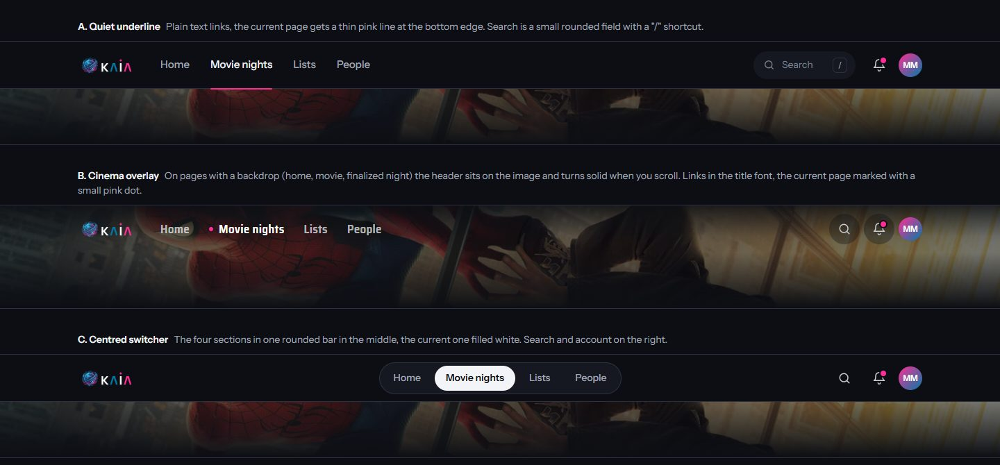 |
| 1337, 1330 | Avatar menu | `components-mockup.html` | 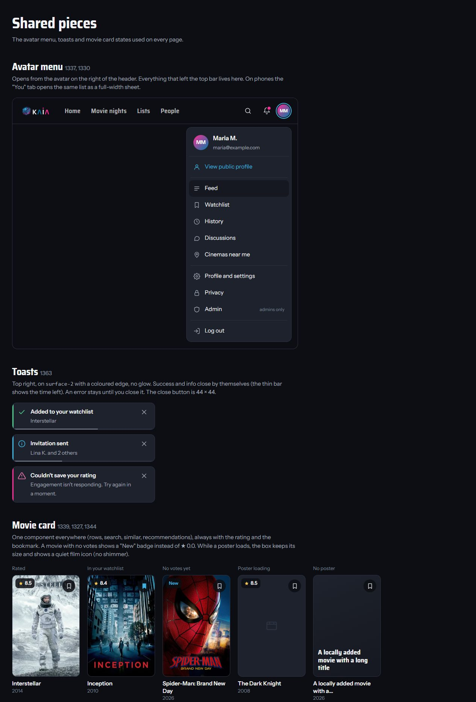 |
| 1338 | Home | `home-mockup.html` |   |
| 1338 | Home section states | `states-mockup.html` | 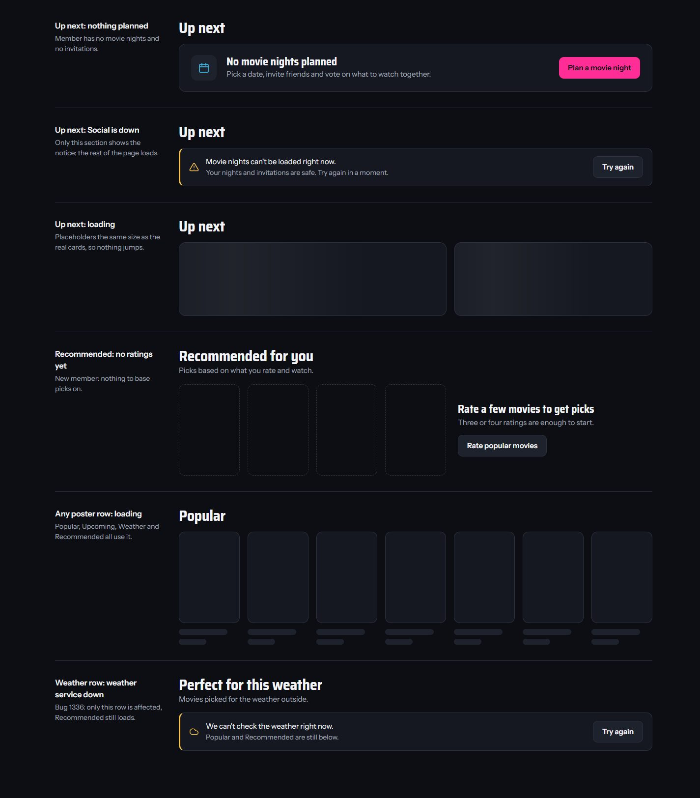 |
| 1339, 1327, 1344 | Movie card states (rated, no votes, loading, no poster) | `components-mockup.html` | same image as the avatar menu |
| 1340, 1328 | Movie page (In lists is in the side panel) | `movie-mockup.html` |  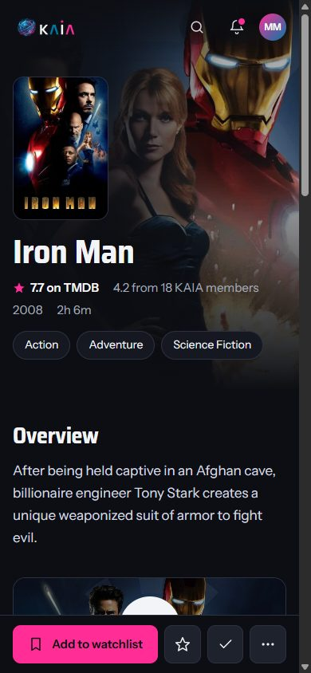 |
| 1341 | Cinemas map | `cinemas-mockup.html` | 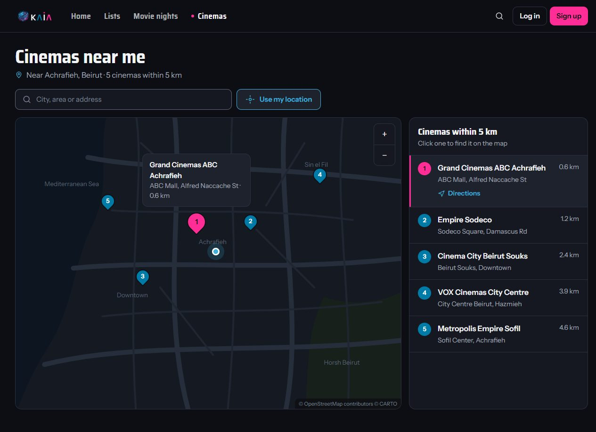 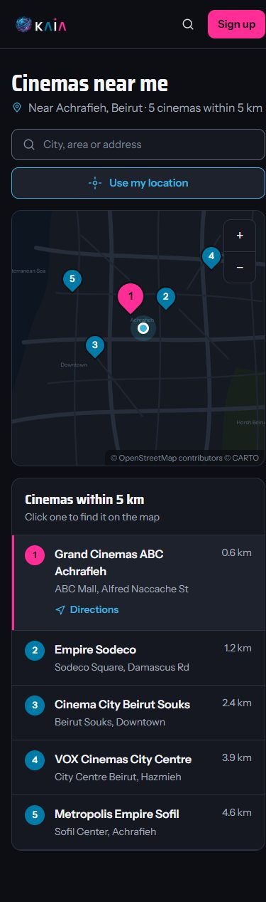 |
| 1343 | People, suggested before a search | `people-mockup.html` | 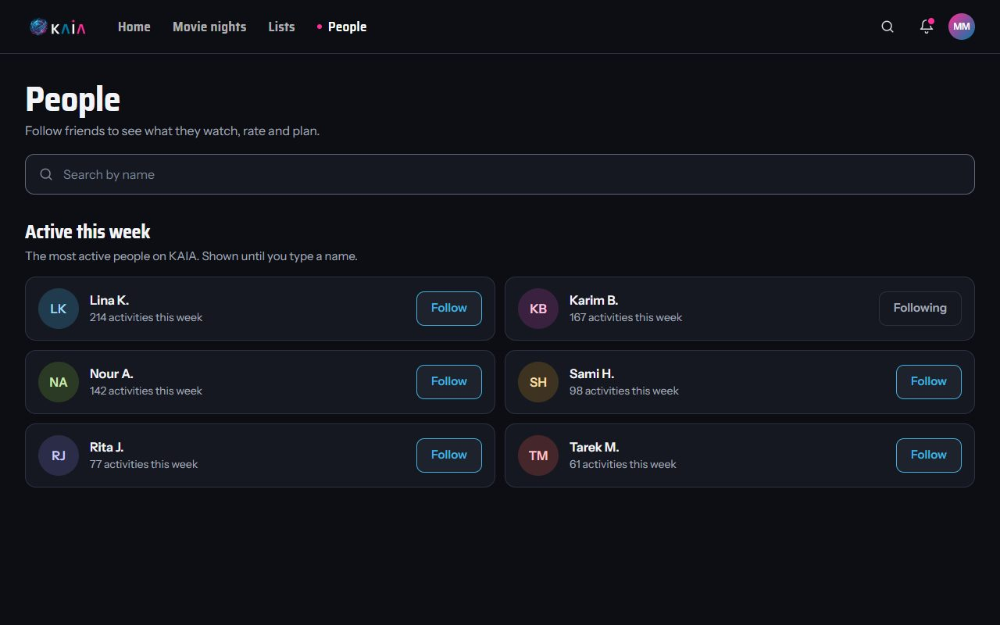 |
| 1345, 1347 | Admin layout and dashboard | `admin-dashboard-mockup.html` | 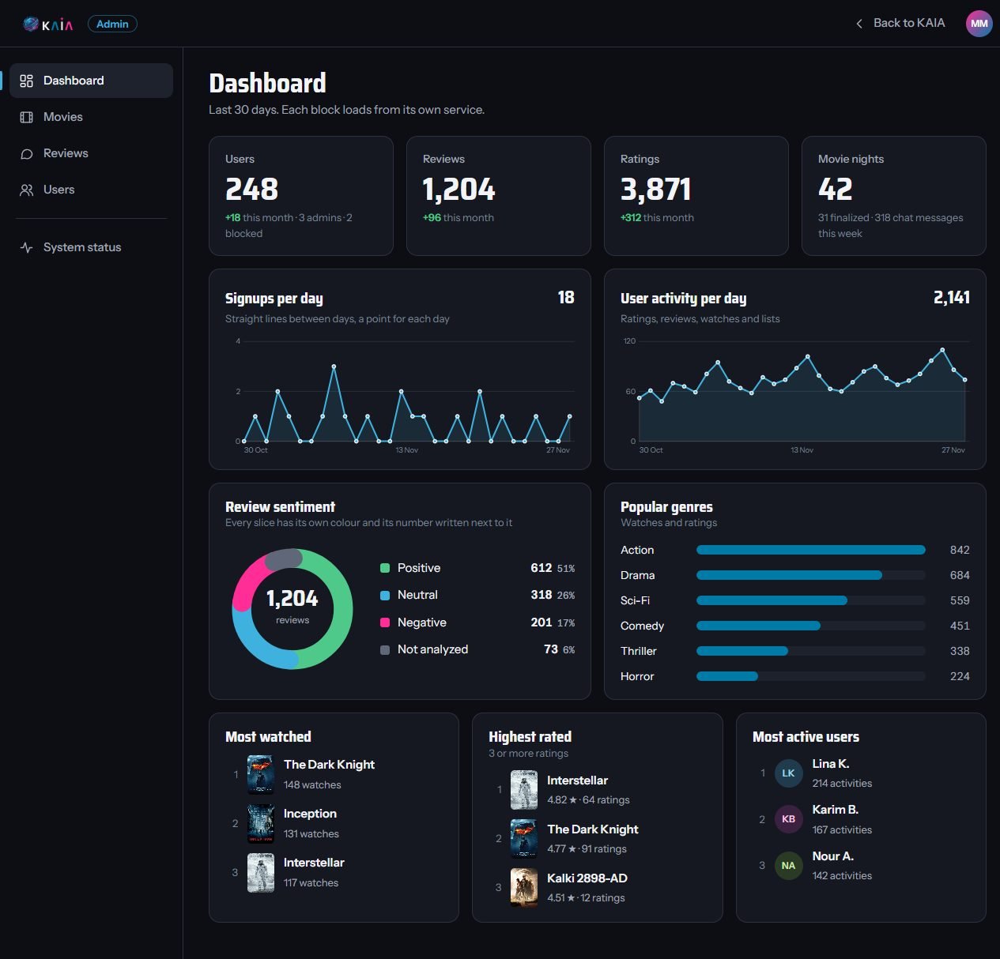 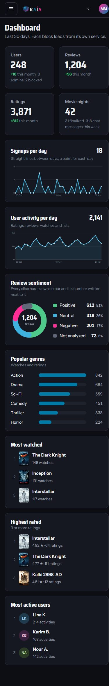 |
| 1345, 1348 | Admin users: table, cards on phones | `admin-users-mockup.html` | 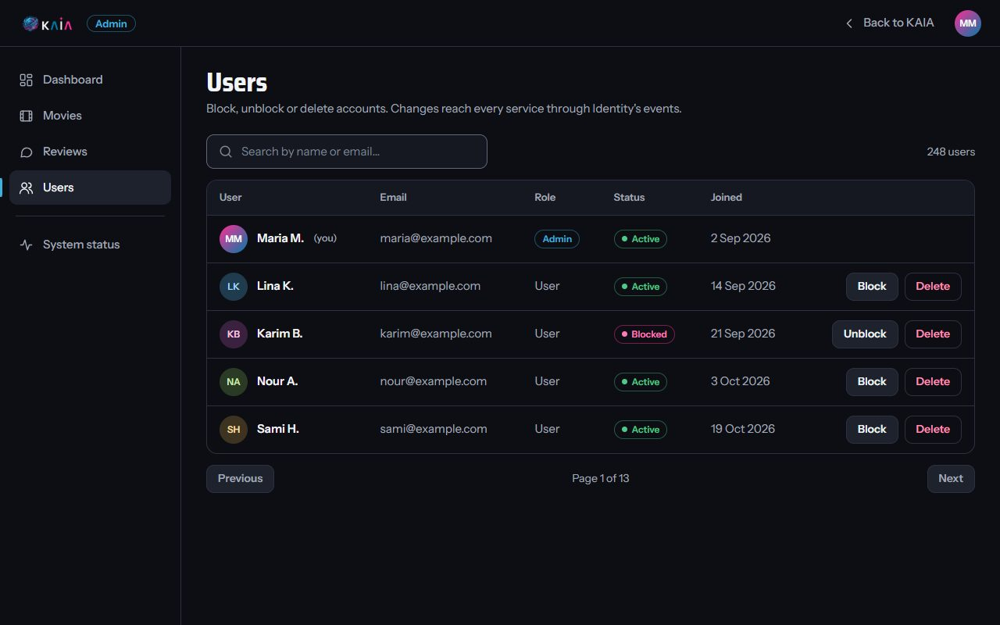 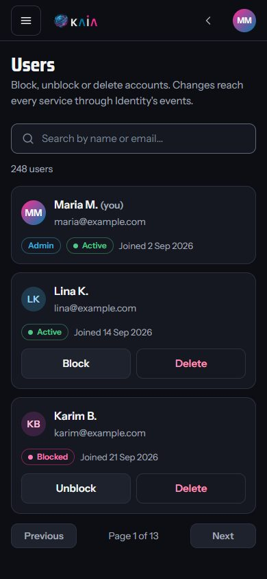 |
| 1346 | Admin system status | `admin-status-mockup.html` | 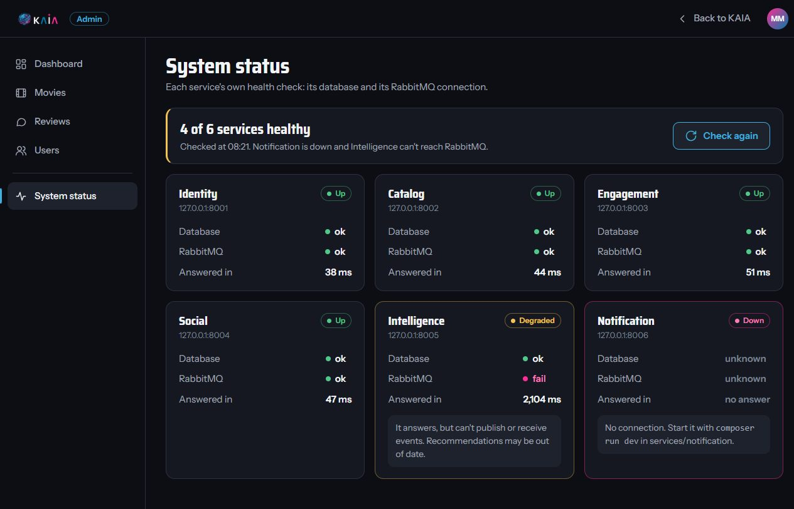 |
| 1363 | Toasts | `components-mockup.html` | same image as the avatar menu |
| 1364 | Movie nights list | `nights-mockup.html` |  |
| 1364 | Movie night, voting open | `night-mockup.html` |   |
| 1364 | Movie night, finalized | `night-mockup.html#final` | 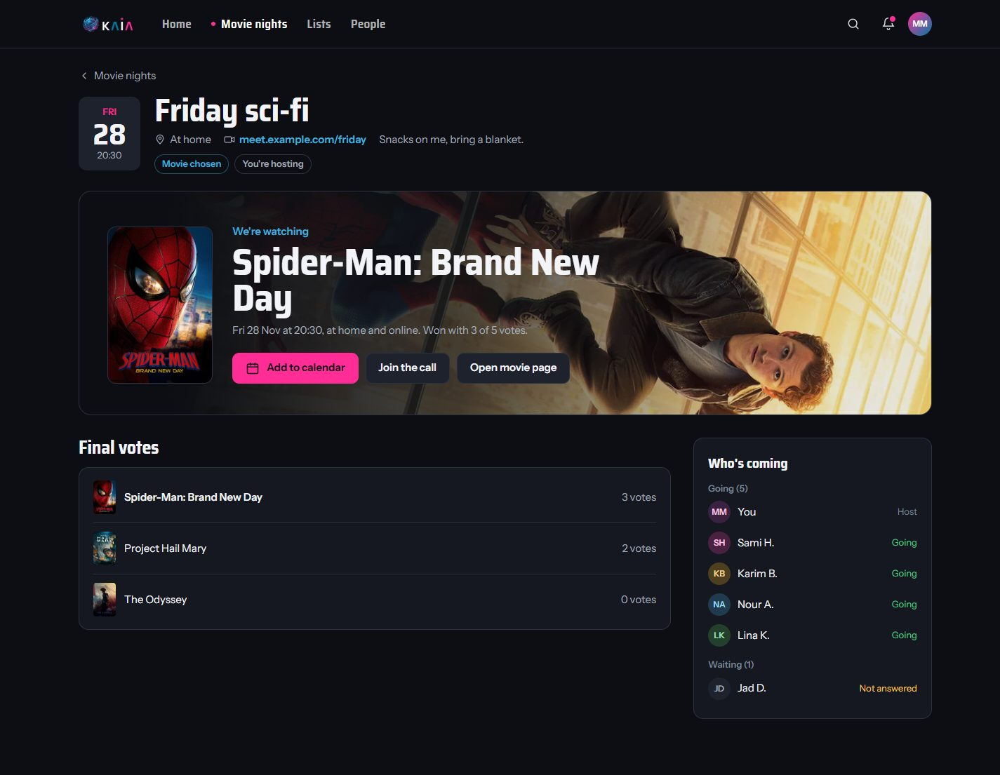 |

Tasks without a row (1329, 1359, 1360, 1361, 1362) change behaviour, not layout: follow the rules below.

## Rules shown in the mockups

- **One pink button per screen** (the main action); blue is for links, focus, selected states and "your vote".
- **Section states:** hide an empty section the user can't act on (trailer, cast, in lists, similar movies); show a
  short empty state with a button for features the user can start (watchlist, recommendations, first movie night);
  always show the one-line notice when a service is down; placeholders the same size as the content while loading.
- **Header:** transparent over the backdrop on home and the movie page, solid after scrolling and on every other page.
- **Phones:** bottom tab bar (Home, Nights, Lists, People, You); on the movie page the actions move to a bar at the
  bottom; admin's sidebar becomes a menu button and tables become cards.
- **Admin:** its own layout (slim top bar with "Back to KAIA", sidebar with the current page marked in blue). Charts:
  straight lines with a point per day, each donut slice with its own colour and its number written next to it.
- **Touch:** every button, link in a menu and icon button is at least 44 px tall on phones.
