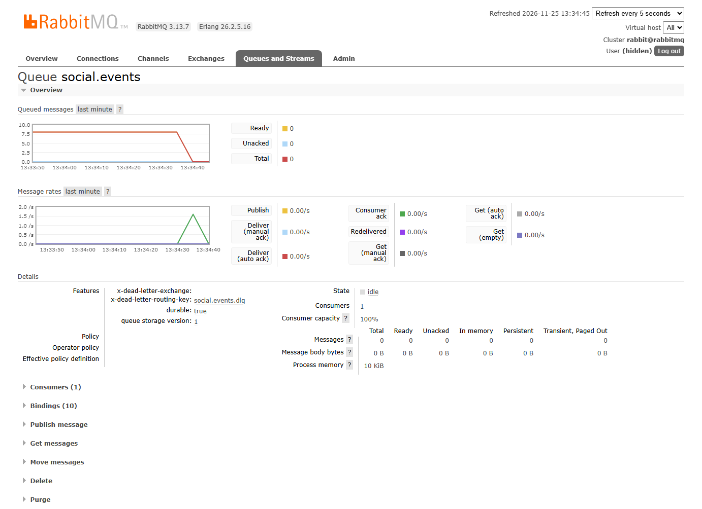
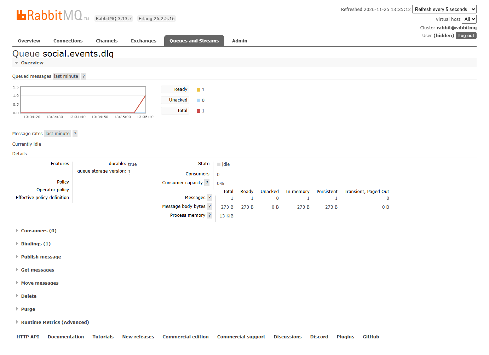
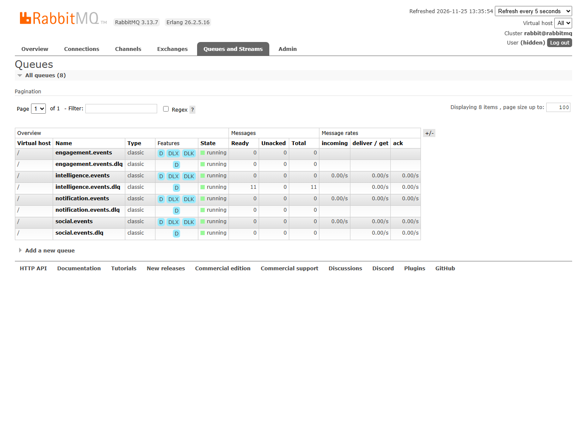

# Resilience checks

What happens to the Gateway when a service or a database stops, and to events when a consumer stops or fails, with
the results of the last runs (failure testing, task 1282, and [event delivery](#event-delivery), task 1283, both
2026-11-25). Run the same checks again after a change to a page's fallback or to the event consumer, and update the
tables in that PR.

## Results

| Service stopped | Gateway pages that show `<x-service-unavailable>` (or a one-line notice) | Elsewhere | Result |
|---|---|---|---|
| Identity | `/users/{id}` (header), followers and following lists, `/profile`, the movie night page ("Who's coming"), `/admin` (user cards, signups chart, most active users), `/admin/users`; the login form says Identity isn't responding | Authors' names become "KAIA member" / "Unknown member", avatars "?" | **1 failure** (AB#1323): `/profile/genres` shows no notice ([below](#failures)) |
| Catalog | Home (Popular, Upcoming, recommendations, genres), `/search`, `/movies/{id}`, `/people/{id}`, `/profile` and `/profile/genres` (genres), `/watchlist`, `/history`, `/lists/{id}`, the movie night page (shortlist, finalize), `/admin` (popular genres, most watched), `/admin/movies` | Movie titles in the feed and reviews become "a movie" / "Unknown movie" | Pass |
| Engagement | Home (the watchlist buttons on the movie cards), `/movies/{id}` (rating, watchlist, lists, "Mark as watched", reviews), `/users/{id}` (recent activity, lists), `/watchlist`, `/history`, `/lists`, `/lists/browse`, `/lists/{id}`, `/admin` (review cards, sentiment, popular genres, most watched, highest rated), `/admin/reviews` | – | **1 failure** (AB#1324): `/lists/{id}/edit` shows the full 503 page ([below](#failures)) |
| Social | `/movies/{id}/discussion`, `/discussions`, `/users/{id}` (follower counts, follow button, recent activity), followers and following lists, `/feed`, `/settings/privacy`, `/movie-nights`, `/movie-nights/{id}` (one notice: the night is Social's), `/admin` (user activity chart, most active users) | – | Pass |
| Intelligence | Home: "Recommended for you" and "Perfect for this weather" (after the location is sent) | Add to calendar shows "Calendar is unavailable right now" (read in the code: no upcoming movie or finalized night in the test data) | Pass |
| Notification | `/notifications`; the navbar bell opens on "Notifications can't be loaded right now" | The bell hides its unread count on every page | Pass |
| `catalog-db` (container) | Same sections as "Catalog" | – | Pass: `GET /api/health` answers **503** `{"status":"degraded","database":"fail","rabbitmq":"ok"}` in about 2 s, and `ok` again as soon as the container is back, without restarting Catalog |

In every run the pages that do not use the stopped service loaded as usual, no page answered a 500, and every page
loaded again after the service was restarted.

## How it was tested

1. Docker up, all six services and the Gateway running, the five demo users from `seeds/demo.json` in Identity. On
   top of the existing data, Lina and Omar follow each other, rated and reviewed movies, and Lina has a watchlist, a
   history, a public list, a movie night with Omar invited and a message in a discussion room, all made through the
   services' APIs.
2. Logged in as `lina@example.com` and as the admin, then **one service stopped at a time** (its `php -S` process,
   like Ctrl+C on `composer run dev`). The event consumers kept running.
3. Every Gateway page visited (35: 4 public, 27 for a user, 4 admin), including the lazy-loaded components (similar
   movies, recommendations, genre browser), the weather row after sending a location and the open notification bell.
   Each page compared with the same page while everything was up: which sections show a notice, which show
   placeholders, which stay the same.
4. The login form tried during the outage, then the service started again before the next one.
5. `docker compose stop catalog-db`, `GET http://127.0.0.1:8002/api/health`, the pages again, then
   `docker compose start catalog-db`.

## Failures

Filed for 1297 (Bug fixing) as tasks tagged `Bug`.

| Bug | Page | Service stopped | Expected | Actual |
|---|---|---|---|---|
| AB#1323 | `/profile/genres` (`App\Livewire\Auth\FavoriteGenres`) | Identity | A notice that the saved genres can't be loaded | `render()` keeps the failure under `identity`, but the view only checks `genres` and `save`: every genre shows as not picked, as if the user had saved none, with no notice. Saving then fails with the "save" notice |
| AB#1324 | `/lists/{id}/edit` (`App\Livewire\Engagement\ListForm`) | Engagement | The form page with `<x-service-unavailable>` and "Try again" | `mount()` calls `EngagementClient::list()` without `fromService()`, so the `ServiceUnavailable` is not caught and the whole page is the 503 error page |

## Notes

- **Waiting time.** A stopped service costs one timeout per request, not one per call (`ServiceOutages`): pages
  that use it took about 3 s longer (up to 8 s for a page that also loads lazy components). Because the notification
  bell is on every page, a stopped Notification service makes every logged-in page about 3 s slower.
- **`/profile` with Identity down** shows one notice for the whole page: the name, genres and password forms all
  need Identity. The link to the privacy settings (which only need Social) is hidden with them.

## Event delivery

What happens to events when Social's `events:consume` stops and when a handler fails (task 1283, 2026-11-25), checked
with the RabbitMQ management UI (http://localhost:15672, "Queues and Streams"). The consumer and the retries are in
`packages/common` (`EventConsumer`), so every consuming service behaves the same way.

| Check | Result |
|---|---|
| No message is lost while the consumer is stopped | **Pass**: 8 events waited in `social.events` with no consumer; once it restarted, all 8 were processed and both feeds were complete |
| A failing message reaches the DLQ | **Pass**: 4 attempts (the first try and 3 retries), then `social.events.dlq` |
| A dead letter is replayed after the fix | **Pass**: `php artisan events:replay-dlq` moved it back, it was processed once and the feed shows it |

### 1. Stop the consumer, then post

1. Lina (`lina@example.com`) and Omar (`omar@example.com`) follow each other, so each one's ratings and reviews are in the other's feed. Before:
   4 entries in each feed.
2. Stop **only** Social's `events:consume` (in `composer run dev`, the `events` process; its `server` keeps
   running). `social.events` shows **Consumers: 0**.
3. Post as Omar: 4 ratings and 2 reviews; as Lina: 1 rating and 1 review. Every request answers `200`/`201`:
   Engagement publishes to the exchange and does not wait for Social.
4. `social.events` shows **8 Ready**: 5 `RatingAdded` and 3 `ReviewCreated`. The feeds still have 4 entries each.

### 2. Restart the consumer

5. Start `events:consume` again. Within a few seconds `social.events` is back to **0**, with **Consumers: 1**.
6. Lina's feed has **10** entries (+6: Omar's 4 ratings and 2 reviews), Omar's **6** (+2: Lina's rating and review).
   Nothing is missing.

### 3. Force a handler error

7. Break Social's database on purpose: `docker exec movieplatform-social-db-1 psql -U social_user -d social_db -c
   "ALTER TABLE activities RENAME TO activities_broken_1283"`.
8. Omar rates a movie. Social's log (`services/social/storage/logs/`) shows `Event RatingAdded failed (attempt 1)`
   to `(attempt 4)` (`relation "activities" does not exist`), then `moved to the dead-letter queue`.
9. `social.events.dlq` shows **1 Ready**; `social.events` is empty, so the next events are not blocked.

### 4. Fix and replay

10. Fix it: rename the table back (`ALTER TABLE activities_broken_1283 RENAME TO activities`).
11. In `services/social`: `php artisan events:replay-dlq` → `Moved 1 message(s) from social.events.dlq to
    social.events`.
12. The consumer processes it at once: one row in `processed_events` for that event id, no new error in the log, and
    the rating is in Lina's feed. (Omar had rated that movie before, so his rating entry is updated in place: the
    feed keeps 10 entries.)

### Notes

- **The retries are immediate.** The 4 attempts happen within the same second, with no wait between them, so a
  failure that lasts longer than that (a database restarting, an outside API down) always ends in the DLQ. That is
  safe, nothing is lost, but someone has to run `events:replay-dlq` afterwards.
- **"Retry up to 3 times"** (`docs/events.md`) means 4 attempts in total: `EventConsumer::RETRIES` is 3 retries
  after the first try.
- **Intelligence's DLQ was not empty**: `intelligence.events.dlq` held 11 `ReviewCreated` messages (visible in the
  screenshots), from 2026-11-18 to today. Intelligence's log says `Azure AI Language is unavailable` on every
  attempt: the sentiment call fails on this laptop (check the key in `secrets/azure_language_key` and
  `AZURE_LANGUAGE_ENDPOINT`). Once it works, `php artisan events:replay-dlq` in `services/intelligence` analyzes those
  reviews.
- In the screenshots the RabbitMQ user name is replaced with "(hidden)": it is a secret (`secrets/rabbitmq_user`).
